# Class Diagram Aset-Pinjam

Sumber Mermaid di bawah dirender otomatis oleh GitHub. Isinya mengikuti kode di
`core/src/main/java/id/ac/upb/asetpinjam/` (bukan rancangan ideal).

- `model` = `id.ac.upb.asetpinjam.model`
- `kontrak` = `id.ac.upb.asetpinjam.kontrak`
- `denda` = `id.ac.upb.asetpinjam.denda`
- `katalog` = `id.ac.upb.asetpinjam.katalog`
- `jadwal` = `id.ac.upb.asetpinjam.jadwal`
- `config` = `id.ac.upb.asetpinjam.config`
- `factory` = `id.ac.upb.asetpinjam.factory`
- `dao` = `id.ac.upb.asetpinjam.dao`
- `exception` = `id.ac.upb.asetpinjam.exception`

```mermaid
classDiagram
    namespace model {
        class Aset {
            <<abstract>>
            -kode: String
            -nama: String
            -status: StatusAset
            -kondisi: Kondisi
            +Aset(kode: String, nama: String)
            +getKode() String
            +getNama() String
            +getStatus() StatusAset
            +getKondisi() Kondisi
            +setNama(nama: String) void
            +setStatus(status: StatusAset) void
            +setKondisi(kondisi: Kondisi) void
            +bisaDipinjam() boolean
            +getJenis() JenisAset
            +hitungDenda(hariTerlambat: int) long*
        }

        class Ruang {
            -kapasitas: int
            +Ruang(kode: String, nama: String, kapasitas: int)
            +getKapasitas() int
            +getJenis() JenisAset
            +hitungDenda(hariTerlambat: int) long
        }

        class Laptop {
            -spesifikasi: String
            -nomorInventaris: String
            +Laptop(kode: String, nama: String, spesifikasi: String, nomorInventaris: String)
            +getSpesifikasi() String
            +getNomorInventaris() String
            +getJenis() JenisAset
            +hitungDenda(hariTerlambat: int) long
        }

        class AlatLab {
            -laboratorium: String
            -tingkatRisiko: TingkatRisiko
            +AlatLab(kode: String, nama: String, laboratorium: String, tingkatRisiko: TingkatRisiko)
            +getLaboratorium() String
            +getTingkatRisiko() TingkatRisiko
            +getJenis() JenisAset
            +hitungDenda(hariTerlambat: int) long
        }

        class Peminjam {
            <<record>>
            +id: String
            +nama: String
        }

        class Peminjaman {
            -id: String
            -peminjam: Peminjam
            -aset: Aset
            -mulai: LocalDateTime
            -selesai: LocalDateTime
            -status: StatusPeminjaman
            +Peminjaman(id: String, peminjam: Peminjam, aset: Aset, mulai: LocalDateTime, selesai: LocalDateTime)
            +getId() String
            +getPeminjam() Peminjam
            +getAset() Aset
            +getMulai() LocalDateTime
            +getSelesai() LocalDateTime
            +getStatus() StatusPeminjaman
            +setStatusDariPenyimpanan(status: StatusPeminjaman) void
            +ubahStatus(baru: StatusPeminjaman) void
        }

        class JenisAset {
            <<enumeration>>
            RUANG
            LAPTOP
            ALAT_LAB
        }

        class StatusAset {
            <<enumeration>>
            TERSEDIA
            DIPINJAM
            RUSAK
        }

        class Kondisi {
            <<enumeration>>
            BAIK
            RUSAK_RINGAN
            RUSAK_BERAT
        }

        class TingkatRisiko {
            <<enumeration>>
            RENDAH
            SEDANG
            TINGGI
        }

        class StatusPeminjaman {
            <<enumeration>>
            DIAJUKAN
            DISETUJUI
            DITOLAK
            DIBATALKAN
            DIPINJAM
            TERLAMBAT
            DIKEMBALIKAN
        }
    }

    namespace kontrak {
        class DapatDipinjam {
            <<interface>>
            +bisaDipinjam() boolean*
        }

        class AturanDenda {
            <<interface>>
            +hitung(aset: Aset, hariTerlambat: int) long*
        }
    }

    namespace denda {
        class DendaFlat {
            +hitung(aset: Aset, hariTerlambat: int) long
        }

        class DendaProgresif {
            -BATAS_HARI_NORMAL: int = 7$
            +hitung(aset: Aset, hariTerlambat: int) long
        }
    }

    namespace katalog {
        class KatalogAset {
            -daftar: List~Aset~
            +tambah(aset: Aset) void
            +semua() List~Aset~
            +cari(kata: String) List~Aset~
            +cari(kata: String, jenis: JenisAset) List~Aset~
        }
    }

    namespace jadwal {
        class JadwalPeminjaman {
            -daftar: List~Peminjaman~
            -kuotaLaptop: int
            +JadwalPeminjaman(kuotaLaptop: int)
            #kuotaLaptop() int
            #daftarMutable() List~Peminjaman~
            +tambah(p: Peminjaman) void
            +bentrok(baru: Peminjaman) boolean
            +semuaUrutMulai() List~Peminjaman~
            +perAset() Map~String,List~Peminjaman~~
            +hapus(id: String) boolean
            +ajukan(baru: Peminjaman) void
        }
    }

    namespace config {
        class Varian {
            -DENDA_PER_HARI: int[]$
            -BATAS_DURASI_JAM: int[]$
            -KUOTA_LAPTOP: int[]$
            -aktif: Varian$
            +nim: String
            +nama: String
            +dendaPerHari: int
            +batasDurasiJam: int
            +kuotaLaptop: int
            -Varian(nim: String, nama: String)
            +dariNim(nim: String, nama: String) Varian$
            +aktif() Varian$
        }
    }

    namespace factory {
        class AsetFactory {
            -AsetFactory()
            +buat(jenis: JenisAset, kode: String, nama: String, atribut: String...) Aset$
        }
    }

    namespace dao {
        class AsetDAO {
            <<interface>>
            +simpan(aset: Aset) void*
            +cariByKode(kode: String) Optional~Aset~*
            +semua() List~Aset~*
            +perbarui(aset: Aset) void*
            +hapus(kode: String) boolean*
        }

        class PeminjamanDAO {
            <<interface>>
            +simpan(peminjaman: Peminjaman) void*
            +cariById(id: String) Optional~Peminjaman~*
            +perbaruiStatus(id: String, status: StatusPeminjaman) boolean*
        }

        class JdbcAsetDAO {
            -sumberKoneksi: Supplier~Connection~
            +JdbcAsetDAO(sumberKoneksi: Supplier~Connection~)
            +simpan(aset: Aset) void
            +cariByKode(kode: String) Optional~Aset~
            +semua() List~Aset~
            +perbarui(aset: Aset) void
            +hapus(kode: String) boolean
        }

        class JdbcPeminjamanDAO {
            -sumberKoneksi: Supplier~Connection~
            -asetDao: AsetDAO
            +JdbcPeminjamanDAO(sumberKoneksi: Supplier~Connection~, asetDao: AsetDAO)
            +simpan(peminjaman: Peminjaman) void
            +cariById(id: String) Optional~Peminjaman~
            +perbaruiStatus(id: String, status: StatusPeminjaman) boolean
        }
    }

    namespace exception {
        class AsetPinjamException {
            +AsetPinjamException(pesan: String)
            +AsetPinjamException(pesan: String, sebab: Throwable)
        }

        class PeminjamanBentrokException {
            +PeminjamanBentrokException()
        }

        class KuotaHabisException {
            +KuotaHabisException()
        }

        class StatusTidakSahException {
            +StatusTidakSahException()
        }

        class DataAksesException {
            +DataAksesException(pesan: String, sebab: Throwable)
        }
    }

    %% --- generalisasi dan realisasi ---
    Aset <|-- Ruang
    Aset <|-- Laptop
    Aset <|-- AlatLab
    DapatDipinjam <|.. Aset
    AturanDenda <|.. DendaFlat
    AturanDenda <|.. DendaProgresif
    AsetDAO <|.. JdbcAsetDAO
    PeminjamanDAO <|.. JdbcPeminjamanDAO
    AsetPinjamException <|-- PeminjamanBentrokException
    AsetPinjamException <|-- KuotaHabisException
    AsetPinjamException <|-- StatusTidakSahException
    AsetPinjamException <|-- DataAksesException

    %% --- agregasi: objek dibuat di luar, lalu dikumpulkan ---
    KatalogAset "1" o-- "0..*" Aset : daftar
    JadwalPeminjaman "1" o-- "0..*" Peminjaman : daftar

    %% --- asosiasi dengan multiplicity ---
    Peminjaman "0..*" --> "1" Peminjam : peminjam
    Peminjaman "0..*" --> "1" Aset : aset

    %% --- ketergantungan ---
    Peminjaman ..> StatusPeminjaman
    Aset ..> StatusAset
    Aset ..> Kondisi
    AlatLab ..> TingkatRisiko
    KatalogAset ..> JenisAset
    AsetFactory ..> Aset
    AsetFactory ..> JenisAset
    Ruang ..> Varian
    Laptop ..> Varian
    AlatLab ..> Varian
    DendaFlat ..> Aset
    DendaProgresif ..> Aset
    JdbcPeminjamanDAO ..> AsetDAO
```

## Keterangan relasi

| Relasi | Arti di kode |
|---|---|
| `Aset <|-- Ruang/Laptop/AlatLab` | Warisan; tiap subclass mengisi `getJenis()` dan `hitungDenda()`. |
| `Aset <|.. DapatDipinjam` | `Aset` mengimplementasikan `bisaDipinjam()`. |
| `AturanDenda <|.. DendaFlat/DendaProgresif` | Dua strategi denda yang bisa saling menggantikan. |
| `KatalogAset o-- Aset` | Agregasi: `KatalogAset.tambah()` menerima objek aset yang sudah dibuat di luar. |
| `JadwalPeminjaman o-- Peminjaman` | Agregasi: `Peminjaman` dibuat pemanggil, lalu disimpan lewat `tambah()`. |
| `Peminjaman --> Peminjam/Aset` | Satu peminjaman menunjuk tepat satu peminjam dan satu aset. |
| `JdbcPeminjamanDAO ..> AsetDAO` | DAO JDBC memakai kontrak `AsetDAO` lewat konstruktor (inversi dependensi). |

Tidak ada relasi composition di kode saat ini: `Peminjaman` tidak membuat sendiri `Peminjam`/`Aset`, dan
`JadwalPeminjaman` tidak membuat sendiri `Peminjaman`. Karena itu semuanya digambar sebagai agregasi.
