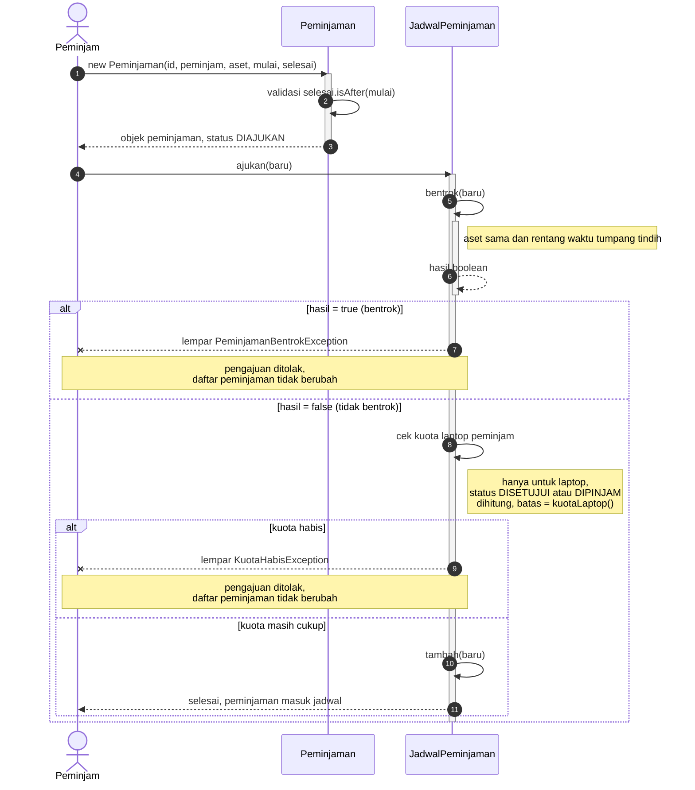

# Sequence Diagram: Pengajuan Peminjaman

Alur memakai kelas dan metode yang benar-benar ada di kode: `Peminjaman` (konstruktor),
`JadwalPeminjaman.ajukan()`, `JadwalPeminjaman.bentrok()`, dan `JadwalPeminjaman.tambah()`.
Fragmen `alt` memisahkan skenario sukses dan skenario bentrok.

## Skenario

| Skenario | Yang terjadi |
|---|---|
| Sukses | `bentrok()` mengembalikan `false`, kuota masih cukup, `tambah()` menyimpan peminjaman. |
| Bentrok | `bentrok()` mengembalikan `true`; `ajukan()` melempar `PeminjamanBentrokException` dan tidak memanggil `tambah()`. |
| Kuota habis | Tidak bentrok, tetapi laptop aktif peminjam sudah mencapai `kuotaLaptop()`; `KuotaHabisException` dilempar. |

Catatan: `ajukan()` masih bertanda TODO minggu 9, sedangkan `bentrok()` sudah diisi pada minggu 7.
Diagram ini mengikuti kontrak di Javadoc dan nama kelas/metode yang sudah ada, bukan menambah kelas baru.
